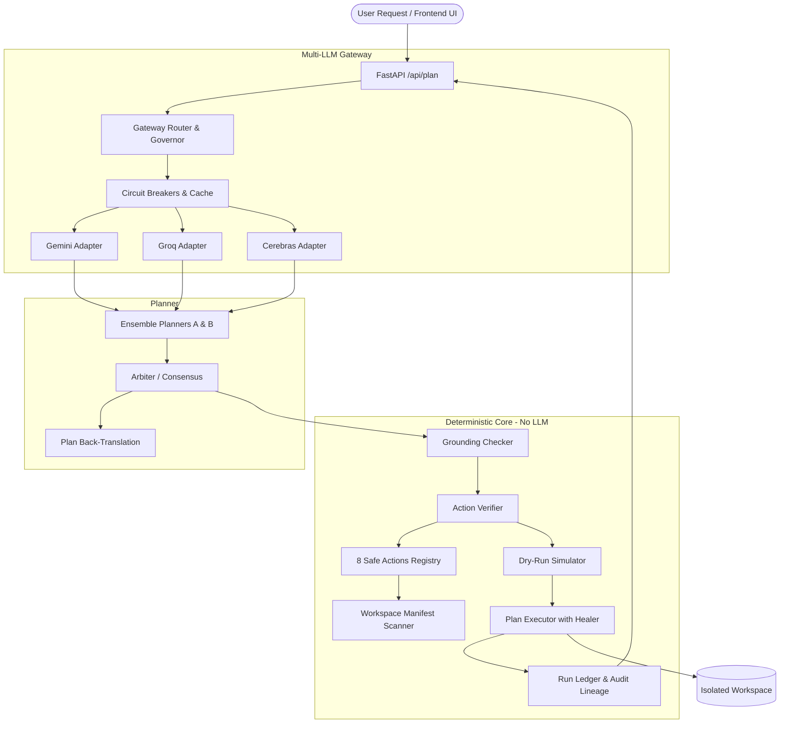

# Hacktober-Fest Multi-LLM Deterministic Planning & Execution Engine

An agentic planning and execution system with multi-LLM routing, deterministic verification, safety boundaries, and sandbox execution.

> [!NOTE]
> **Data Notice**: All workspace data in this repository is strictly **simulated demo data** for testing and evaluation purposes.

---

## 🏛 Architecture Overview



---

## 🚀 Quickstart & Setup

### Prerequisites
- Python 3.10+
- Node.js or any static file server (for frontend testing) or run directly in browser

### 1. Backend Setup
```bash
# Navigate to backend
cd backend

# Create virtual environment
python -m venv venv
# Windows:
.\venv\Scripts\activate
# Linux/macOS:
source venv/bin/activate

# Install dependencies
pip install -r requirements.txt

# Configure environment variables
cp ../.env.example .env
# Edit .env with your LLM API keys
```

### 2. Run the Backend Server
```bash
uvicorn main:app --reload --port 8000
```
Health endpoint will be available at: `http://localhost:8000/api/health`

### 3. Open the Frontend
Open `frontend/index.html` directly in your browser or serve it:
```bash
# E.g. using python http.server
cd frontend
python -m http.server 3000
```
Open `http://localhost:3000` in your web browser.

### 4. Run Smoke Test
```bash
python scripts/smoke_test.py
```

### 5. Run Evaluations
```bash
python eval/run_eval.py
```

---

## 📂 Project Structure

```
Hacktober-Fest/
├── README.md                    # Architecture diagram, setup, simulated data notice
├── LICENSE                      # MIT License
├── .gitignore                   # Ignore rules (.env, __pycache__/, workspace/)
├── .env.example                 # Environment variable templates
├── render.yaml                  # Render deployment configuration
│
├── backend/
│   ├── requirements.txt         # Dependencies
│   ├── main.py                  # FastAPI application & endpoints
│   ├── config.py                # Configuration and mode flags
│   │
│   ├── gateway/                 # Multi-LLM provider & resilience layer
│   │   ├── providers.py         # Adapters (Gemini, Groq, Cerebras)
│   │   ├── router.py            # Role routing and failover
│   │   ├── governor.py          # Rate limiting & token quotas
│   │   ├── breaker.py           # Circuit breaker patterns
│   │   └── cache.py             # Plan caching and demo warmers
│   │
│   ├── core/                    # Deterministic validation & execution (No LLM)
│   │   ├── registry.py          # 8 safe actions with effect labels
│   │   ├── verifier.py          # AST & schema validation
│   │   ├── grounding.py         # Grounding & hallucination check
│   │   ├── manifest.py          # Workspace file/column scanner
│   │   ├── dryrun.py            # Simulation without side effects
│   │   ├── executor.py          # Safe execution engine
│   │   ├── healer.py            # Failure recovery & resume
│   │   └── ledger.py            # Audit log & lineage tracker
│   │
│   ├── planner/                 # Plan generation & consensus
│   │   ├── prompts.py           # Planner, critic, repairer prompts
│   │   ├── ensemble.py          # Dual-planner generation
│   │   ├── arbiter.py           # Agreement/disagreement logic
│   │   └── explain.py           # Natural language back-translation
│   │
│   └── workspace_seed/          # Simulated scenario data files
│
├── frontend/                    # Plain HTML/JS UI (no build step)
│   ├── index.html               # Main dashboard
│   ├── app.js                   # Application logic
│   ├── styles.css               # Modern UI styling
│   └── config.js                # Backend API configuration
│
├── eval/
│   ├── prompts.json             # Benchmark test requests
│   └── run_eval.py              # Evaluation harness & accuracy report
│
└── scripts/
    └── smoke_test.py            # End-to-end integration test
```

---

## 🔒 Deterministic Safety Core
The execution engine enforces:
1. **Action Whitelisting**: Only 8 safe actions are permitted.
2. **Grounding Verification**: Plan arguments are checked against the manifest and request.
3. **Dry-Run Simulation**: State transitions are pre-validated before applying side effects.
4. **Append-Only Ledger**: Full provenance tracking for every executed step.
